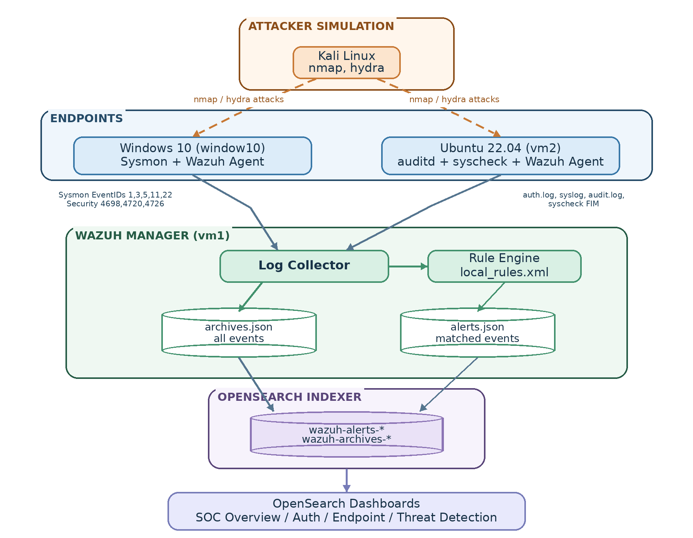
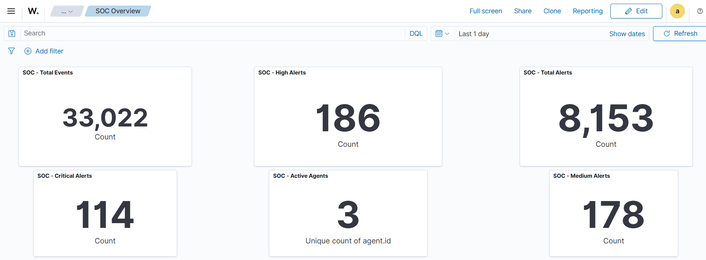

# Enterprise SOC Detection & Incident Response Lab

A hands-on, multi-platform Security Operations Center (SOC) home lab built with **Wazuh**, **Windows 10**, **Ubuntu Linux**, **Sysmon**, **auditd**, **OpenSearch Dashboards**, and **Kali Linux**. The project focuses on collecting endpoint telemetry, engineering custom detections, validating alert logic with controlled tests, investigating security events, and documenting analyst response workflows.

> **Project type:** Personal learning and portfolio lab. Attack simulations are intended only for systems you own or are explicitly authorized to test. Alerts generated in a lab are not, by themselves, proof of a real compromise.

## At a glance

- **SIEM / security monitoring:** Wazuh Manager, Wazuh Indexer, Wazuh Dashboard
- **Endpoints:** Windows 10 and Ubuntu Linux
- **Telemetry:** Windows Sysmon and Security events; Linux authentication/system logs, auditd where configured, and File Integrity Monitoring (FIM)
- **Detection engineering:** 41 custom Wazuh rule definitions documented in the rule inventory
- **Use cases:** SSH brute force, suspicious/encoded PowerShell, process lineage, network scanning, account changes, sudo activity, persistence, and DNS/network hunting
- **Operations:** Dashboards, evidence-based investigation reports, timelines, MITRE ATT&CK mappings, and SOC triage playbooks

## Project goals

1. Build a SOC monitoring environment with Windows and Linux telemetry centralized in Wazuh.
2. Create and organize custom detection rules for common endpoint and authentication behaviors.
3. Test detections with captured events, controlled lab activity, positive tests, and negative tests.
4. Investigate alerts using timestamps, process details, users, source/destination information when available, and supporting endpoint logs.
5. Document detection strengths, false-positive considerations, data gaps, and platform-specific limitations instead of treating every alert as malicious.

## Architecture



The lab uses the following logical flow:

1. **Windows 10 endpoint** sends Sysmon and selected Windows Security telemetry through the Wazuh agent.
2. **Ubuntu endpoint (VM2)** sends authentication/system logs and configured auditd/FIM events through the Wazuh agent.
3. **Kali Linux** generates controlled test activity, such as port scans and SSH authentication attempts. The project does not assume Kali has a Wazuh agent installed.
4. **Wazuh Manager (VM1)** receives events and evaluates custom rules in `local_rules.xml`.
5. Matched alerts are shipped to the **Wazuh Indexer**; raw-event archives are available when archive collection and shipping are configured.
6. **Wazuh Dashboard / OpenSearch Dashboards** are used to search events, review alerts, and view SOC dashboards.

### Lab components

| Component | Role | Main responsibility |
|---|---|---|
| **VM1 — Ubuntu** | Wazuh Manager, Indexer, Dashboard | Rule evaluation, alert processing, indexing, searching, and dashboards |
| **VM2 — Ubuntu 22.04** | Linux endpoint with Wazuh agent | SSH authentication, sudo activity, account management, system logs, audit events if enabled, and cron-related FIM |
| **Windows 10** | Windows endpoint with Wazuh agent and Sysmon | Process creation, parent/child process details, network connections, DNS queries, account changes, and scheduled-task events |
| **Kali Linux** | Authorized test/source host | Controlled SSH brute-force and network-scanning simulations |

See the [`01-architecture`](01-architecture/) folder for the full report and diagrams.

- [Architecture and detection engineering report (PDF)](01-architecture/Wazuh-SOC-Lab-Architecture-Report.pdf)
- [Editable architecture report (DOCX)](01-architecture/Wazuh-SOC-Lab-Architecture-Report.docx)
- [Tiered sudo detection diagram](01-architecture/diagrams/02-Tiered-Sudo-Detection.png)

## Telemetry collected

### Windows telemetry

| Source | Events / fields | Purpose |
|---|---|---|
| Sysmon Event ID 1 | Process image, command line, parent process, user, process IDs/GUIDs, hashes where available | PowerShell and process-lineage investigation |
| Sysmon Event ID 3 | Network connection, process image, destination address/port where available | Network activity and possible scanning/beaconing investigation |
| Sysmon Event ID 5 | Process termination | Process lifecycle context |
| Sysmon Event ID 11 | File creation | File activity context |
| Sysmon Event ID 22 | DNS query name, process context, query result/status | DNS hunting and suspicious-domain triage |
| Security Event ID 4720 | Local user account created | Account lifecycle detection |
| Security Event ID 4726 | Local user account deleted | Account removal investigation |
| Security Event ID 4698 | Scheduled task created | Persistence-related investigation |
| PowerShell Operational events | Events such as 4103/4104 when logging is enabled | Additional command and script context |

### Linux telemetry

| Source | Purpose |
|---|---|
| `/var/log/auth.log` | SSH failures/successes, sudo activity, and account-management activity |
| `/var/log/syslog` and other available system logs | Host and service events; availability depends on endpoint configuration |
| `auditd` | Process execution, selected file/configuration watches, and outbound `connect()` events when the corresponding rules are enabled |
| Wazuh Syscheck / FIM | Changes to monitored paths, including cron-related persistence test files |

Read the [endpoint telemetry guide](03-endpoint-telemetry/Endpoint-Telemetry-VM1-VM2-Windows-Kali.md) for collection assumptions, configuration examples, and verification commands. It distinguishes observed evidence from recommended telemetry that still needs verification on the live machines.

## Custom detection coverage

The rule inventory documents **41 custom Wazuh rule definitions**. Rule logic, matching fields, source groups, and caveats are organized by category in [`04-detection-rules`](04-detection-rules/).

| Detection area | Rule IDs | What it detects | Platform |
|---|---|---|---|
| Windows process visibility | `100100`–`100102`, `100120`, `100700` | Selected application/process events and general Sysmon process visibility | Windows |
| SSH brute force and subsequent successful login | `100001`, `100200`, `100201` | Repeated SSH authentication failures and a successful login correlated with prior failures | Linux |
| Suspicious PowerShell | `100300` | Selected suspicious PowerShell command-line characteristics | Windows |
| Encoded PowerShell | `100301` | Encoded PowerShell command-line patterns | Windows |
| Suspicious process lineage | `100302`–`100304` | Office, browser, or PDF-reader process spawning a shell/script interpreter | Windows |
| Network connection / port scanning | `100400`, `100401` | Base Sysmon network events and repeated/multi-port connection patterns | Windows |
| Account lifecycle | `100501`, `100503`, `100510`–`100513` | Account creation/deletion and related account-lifecycle patterns | Windows and Linux |
| Sudo / privilege escalation | `100520`–`100525` | Tiered sudo activity, sensitive commands, shell-spawn/escape patterns, download/execute patterns, and repeated sudo failures | Linux |
| Persistence | `100530`–`100533` | Cron-related file changes and Windows scheduled-task creation/content | Linux and Windows |
| DNS, network, possible C2 hunting | `100600`–`100605`, `100610`–`100613` | DNS/network heuristics and repeated process-based network activity | Windows and Linux |

### Rule-validation notes

- A detection match is a signal to investigate, not a final verdict. PowerShell flags, account creation, cron changes, uncommon DNS names, and repeated connections can occur during legitimate administration or testing.
- The tested Linux auditd/Wazuh path did not expose structured destination IP/port fields as consistently as Sysmon. Linux network hunting is therefore more process-oriented in this lab.
- Linux port-scan follow-up rules `100620` and `100621` are described in the test-case documentation as **not fully validated**; they are not counted among the 41 rules in the extracted inventory.
- Rule `100511` is labelled as an elevated account-creation rule, but account/group membership must be verified before concluding that privileges were granted.
- A DNS/TLD match or repeated connection alone does not prove command-and-control (C2).

See [`RULE-INVENTORY.md`](04-detection-rules/RULE-INVENTORY.md) for the full rule index and [MITRE ATT&CK mapping](08-mitre-mapping/MITRE-ATTACK-Mapping-All-Wazuh-Detections.md) for technique mappings and caveats.

## Detection test cases and attack simulations

The test-case documents describe how each rule is exercised in the lab, expected outcomes, negative tests, verification steps, and relevant dashboard searches. Run simulations only against authorized lab systems.

| Test case | Scenario | Guide |
|---|---|---|
| Detection 002 | SSH brute force and successful login after failed attempts | [Test case](05-attack-scenarios/detection-002-brute-force.md) |
| Detection 003 | Suspicious PowerShell | [Test case](05-attack-scenarios/detection-003-suspicious-powershell.md) |
| Detection 004 | Encoded PowerShell | [Test case](05-attack-scenarios/detection-004-encoded-powershell.md) |
| Detection 005 | Suspicious parent-to-child process lineage | [Test case](05-attack-scenarios/detection-005-parent-child-process.md) |
| Detection 006 | Port-scanning detection | [Test case](05-attack-scenarios/detection-006-port-scanning.md) |
| Detection 007 | User-account creation/deletion | [Test case](05-attack-scenarios/detection-007-user-creation.md) |
| Detection 008 | Tiered sudo / privilege escalation | [Test case](05-attack-scenarios/detection-008-privilege-escalation.md) |
| Detection 009 | Cron and scheduled-task persistence | [Test case](05-attack-scenarios/detection-009-persistence.md) |
| Detection 010 | DNS/network activity and possible C2 indicators | [Test case](05-attack-scenarios/detection-010-network-activity.md) |

## SOC dashboards

Dashboard screenshots are stored in [`10-dashboards`](10-dashboards/).

### SOC Overview



### Additional dashboards

| Dashboard | Screenshot |
|---|---|
| Authentication Overview | [View image](10-dashboards/Authentication%20overview.png) |
| Endpoint Overview | [View image](10-dashboards/Endpoint%20Overview.png) |
| File Integrity Monitoring | [View image](10-dashboards/File-integrity-monitoring.png) |
| Threat Detection Overview | [View image](10-dashboards/Threat-Detection-Overview.png) |
| Threat Hunting | [View image](10-dashboards/threat%20hunting%20dashboard.png) |
| MITRE ATT&CK | [View image](10-dashboards/mitre-attack.png) |
| Vulnerability Detection | [View image](10-dashboards/vulnerability-detection.png) |

The project report describes panels such as total events/alerts, severity counts, active agents, failed and successful logins, top users/source IPs, process activity, file changes, DNS queries, network connections, and threat-category views. Exact fields and panels depend on the configured index patterns and ingested events.

## Investigations and incident reports

Investigation folders contain detection narratives, supporting evidence screenshots, event timelines, and—in applicable cases—PDF/DOCX reports. These are **lab investigation reports**, not claims that a real production compromise occurred.

| Investigation | Focus | Entry point |
|---|---|---|
| IR-001 | SSH brute-force activity and a subsequent successful login | [Investigation folder](06-investigations/001-SSH-Brute-Force/README.md) · [PDF report](07-incident-response/IR-001-SSH-Brute-Force-Investigation.pdf) |
| Detection 002–003 | Suspicious and encoded PowerShell | [Investigation folder](06-investigations/002-003%20Suspicious-Powershell-Detection%20and%20Encoded-Powershell/README.md) · [PDF report](07-incident-response/PowerShell-Detection-Report.pdf) |
| Detection 004 | Suspicious parent/child process lineage | [Investigation folder](06-investigations/004-%20Suspicious-Powershell-parent-child-process/README.md) · [PDF report](07-incident-response/Detection-004-Process-Lineage-Report.pdf) |
| Detection 005 | Windows/Linux account creation and lifecycle | [Investigation folder](06-investigations/005-Suspicious%20Account%20Creation/README.md) · [PDF report](07-incident-response/Detection-005-Account-Creation-Report.pdf) |
| Detection 006 | Tiered sudo activity / privilege escalation | [Investigation folder](06-investigations/006-Sudo-abuse/README.md) · [PDF report](07-incident-response/Detection-006-Sudo-Abuse-Report.pdf) |
| Detection 007 | Cron and scheduled-task persistence monitoring | [Investigation folder](06-investigations/007-Persistence-Monitoring/README.md) · [PDF report](07-incident-response/Detection-007-Persistence-Report.pdf) |
| Detection 008 | DNS and network hunting | [Investigation folder](06-investigations/008-Network-Hunting/README.md) · [PDF report](07-incident-response/Detection-008-DNS-Network-Hunting-Report.pdf) |

Review evidence and conclusions together. A successful SSH login after failures requires checking whether the activity was authorized and what happened afterward. Cron or scheduled-task changes require examining their content and execution. DNS queries alone do not establish C2.

## SOC triage playbooks

[`09-playbooks`](09-playbooks/) contains analyst-facing playbooks following a repeatable structure:

1. What triggered the alert
2. Immediate triage checks
3. True-positive indicators
4. False-positive indicators
5. Investigation steps and useful queries/commands
6. Containment considerations for confirmed malicious activity
7. Escalation criteria
8. Closure notes and required documentation

| Playbook | Use case |
|---|---|
| [Brute force](09-playbooks/playbook-002-brute-force.md) | SSH brute force and success-after-failure correlation |
| [Suspicious PowerShell](09-playbooks/playbook-003-suspicious-powershell.md) | Suspicious PowerShell command line |
| [Encoded PowerShell](09-playbooks/playbook-004-encoded-powershell.md) | Encoded commands and safe triage |
| [Parent/child process](09-playbooks/playbook-005-parent-child-process.md) | Office/browser/PDF reader spawning a shell |
| [Port scanning](09-playbooks/playbook-006-port-scanning.md) | Repeated destination-port activity |
| [Account changes](09-playbooks/playbook-007-user-creation.md) | New/deleted user accounts |
| [Sudo abuse](09-playbooks/playbook-008-privilege-escalation.md) | Sensitive sudo commands and shell patterns |
| [Persistence](09-playbooks/playbook-009-persistence.md) | Cron and scheduled-task activity |
| [Network activity](09-playbooks/playbook-010-network-activity.md) | DNS/network heuristics and possible C2 indicators |

## Installation and reproduction

Follow the role-specific guides in `02-installation/` and adapt IP addresses, package versions, and configuration paths to your environment.

1. [Install VM1 — Wazuh Manager, Indexer, and Dashboard](02-installation/install-vm1-manager.md).
2. [Install VM2 — Ubuntu Wazuh Agent and telemetry](02-installation/install-vm2-ubuntu-agent.md).
3. [Install Windows agent and Sysmon](02-installation/install-windows-agent.md).
4. [Prepare Kali as the authorized test/source host](02-installation/install-kali-attacker.md).
5. Review the [endpoint telemetry plan](03-endpoint-telemetry/Endpoint-Telemetry-VM1-VM2-Windows-Kali.md).
6. Load custom rules carefully and validate syntax before relying on them.
7. Confirm agents are active and raw events reach the manager before troubleshooting a rule that does not alert.
8. Run a positive and a benign negative test for each detection, then document the result and any limitation.

### Validation workflow

1. **Collection:** Confirm endpoint events reach the manager/archive when raw-event archiving is configured.
2. **Decoding:** Use `wazuh-logtest` to inspect event decoding and field availability.
3. **Rule validation:** Validate the custom rule configuration before relying on it.
4. **Positive test:** Generate an authorized test event and verify the expected rule ID.
5. **Negative test:** Exercise nearby benign behavior and confirm the rule does not unnecessarily escalate it.
6. **Investigation:** Correlate alerts with endpoint details, user/process context, timestamps, and supporting logs.

Useful commands on the Wazuh server include:

```bash
sudo systemctl status wazuh-manager
sudo systemctl status wazuh-indexer
sudo systemctl status wazuh-dashboard
sudo /var/ossec/bin/wazuh-logtest
sudo /var/ossec/bin/wazuh-analysisd -t
sudo tail -f /var/ossec/logs/ossec.log
sudo tail -f /var/ossec/logs/alerts/alerts.json
```

Service names, index patterns, paths, and command availability may differ by installation. Back up `ossec.conf`, rule files, and Sysmon configuration before editing them.

## Repository structure

```text
.
├── README.md
├── 01-architecture/
│   └── diagrams and architecture report
├── 02-installation/
│   └── VM1, VM2, Windows agent, and Kali setup guides
├── 03-endpoint-telemetry/
├── 04-detection-rules/
│   ├── README.md
│   ├── RULE-INVENTORY.md
│   └── rule files by category
├── 05-attack-scenarios/
│   └── detection test cases
├── 06-investigations/
│   └── investigation notes, evidence, and timelines
├── 07-incident-response/
│   └── PDF investigation/report copies
├── 08-mitre-mapping/
├── 09-playbooks/
├── 10-dashboards/
└── 11-screenshots/
```

## Tools and skills demonstrated

- **SIEM / security monitoring:** Wazuh, OpenSearch Dashboards, centralized logging, alert review, and agent health checks
- **Detection engineering:** Custom Wazuh rules, rule testing, correlation concepts, alert severity, positive and negative testing
- **Endpoint telemetry:** Sysmon, Windows Security events, Linux authentication logs, auditd, FIM/syscheck
- **SOC operations:** Alert triage, event correlation, evidence collection, event timelines, investigation reports, response playbooks
- **Threat detection:** Brute force, PowerShell, process lineage, account lifecycle, privilege escalation, persistence, port scanning, DNS/network hunting
- **Threat framework:** MITRE ATT&CK mapping and documentation of mapping confidence and limitations

## Known limitations

This is a home lab, not a production SOC deployment. The project documents several constraints discovered during testing:

- **Windows/Linux telemetry parity is incomplete.** Sysmon exposes structured network and DNS fields that were not available equivalently from the tested Linux auditd/Wazuh pipeline.
- **Linux network visibility is narrower.** The tested auditd `connect()` events did not reliably provide parsed destination address/port fields, so Linux detections emphasize process identity and repeated activity where applicable.
- **Audit noise matters.** Linux `connect()` can include local Unix-domain socket activity; the documented audit-rule filtering was added to reduce this noise.
- **Event collection gaps can look like detection failures.** Firewalls, unavailable logs, logging configuration, and test-tool behavior can prevent events from reaching Wazuh.
- **Heuristics require context.** Encoded PowerShell, unusual DNS names, uncommon ports, account changes, and cron/task changes are not independently proof of malicious activity.
- **Some rules require additional validation.** See the rule inventory and test-case documents before describing a detection as production-ready.

These limitations are included deliberately so the project demonstrates analytical judgement as well as technical implementation.

## Safety and privacy

- Run scans, brute-force simulations, and other tests only against isolated lab systems or systems for which you have explicit permission.
- Use benign test commands and test accounts where possible, and clean up test artifacts after testing.
- Do not publish passwords, tokens, personal data, public IPs, or unredacted sensitive logs/screenshots.
- Treat sample IPs, usernames, domains, and timestamps as lab evidence that may change between runs.
- Do not interpret a lab alert as a confirmed real-world incident without corroborating evidence.

## References

- [Wazuh documentation](https://documentation.wazuh.com/current/)
- [Wazuh ruleset](https://documentation.wazuh.com/current/user-manual/ruleset/index.html)
- [Sysmon documentation](https://learn.microsoft.com/sysinternals/downloads/sysmon)
- [MITRE ATT&CK](https://attack.mitre.org/)

## Repository

**GitHub:** [Enterprise-SOC-Detection-Incident-Response-Lab](https://github.com/vipinsky/Enterprise-SOC-Detection-Incident-Response-Lab)

This project documents a practical learning path through endpoint telemetry, custom detections, alert triage, incident investigation, and detection limitations. Feedback that improves detection quality, reproducibility, or clarity is welcome.
